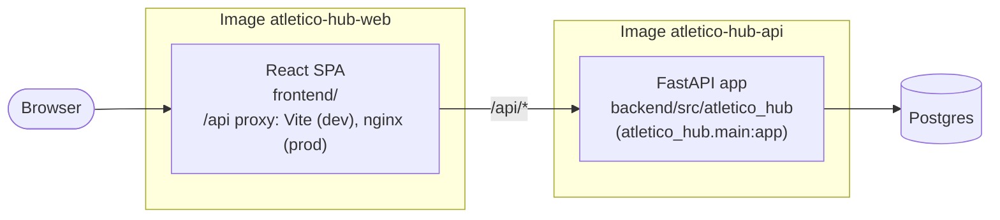

# Architecture

How Atletico Hub is built today. The decisions behind it, with their rejected alternatives, are in [docs/documents/architecture/adr/](docs/documents/architecture/adr/README.md); the current behavior of each capability is in [openspec/specs/](openspec/specs).

## Overview

Atletico Hub is a web app with a separate API. The browser loads the web app from its own image and reaches the API through it, under `/api` ([ADR-0004](docs/documents/architecture/adr/0004-web-app-ships-as-its-own-image-and-reaches-the-api-under-api.md)). The API keeps the data in Postgres.

## Components

| Component | Code | Responsibility |
|---|---|---|
| Web app | `frontend/` | Pages for players and staff; calls the API through the generated client `frontend/src/lib/api/` ([ADR-0003](docs/documents/architecture/adr/0003-web-app-is-a-react-spa-on-vite.md)) |
| API | `backend/src/atletico_hub/` | HTTP routes, business rules, access to the database ([ADR-0002](docs/documents/architecture/adr/0002-backend-on-python-fastapi-and-postgres.md)) |
| Database | Postgres | The team's data |

## Boundaries

- The web app reaches the API only through `/api` on its own origin, and only through the generated client.
- The API is the only component that reads or writes the database.
- Business rules live in the API. The web app checks input for usability only; the API checks it again.
- Code is grouped by feature, not by kind ([CODE_GUIDELINES.md](CODE_GUIDELINES.md#code-patterns)).

## Today

The app holds only the skeleton: the API answers `GET /health` and the web app shows the home page. Each feature arrives as an OpenSpec change, which updates this document when it changes the components or their boundaries.
