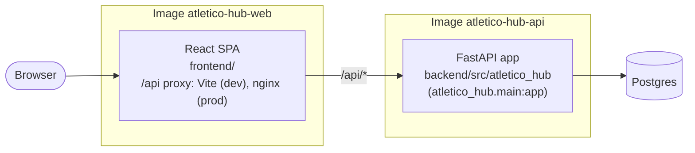

# Architecture

How Atletico Hub is built today. The decisions behind it, with their rejected alternatives, are in [docs/documents/architecture/adr/](docs/documents/architecture/adr/README.md); the current behavior of each capability is in [openspec/specs/](openspec/specs).

## Overview

Atletico Hub is a web app with a separate API. The browser loads the web app from its own image and reaches the API through it, under `/api` ([ADR-0004](docs/documents/architecture/adr/0004-web-app-ships-as-its-own-image-and-reaches-the-api-under-api.md)). The API keeps the data in Postgres.

## Components

| Component | Code | Responsibility |
|---|---|---|
| Web app | `frontend/` | Pages for players and staff; calls the API through the generated client `frontend/src/lib/api/` ([ADR-0003](docs/documents/architecture/adr/0003-web-app-is-a-react-spa-on-vite.md)) |
| API | `backend/src/atletico_hub/` | HTTP routes, business rules, access to the database ([ADR-0002](docs/documents/architecture/adr/0002-backend-on-python-fastapi-and-postgres.md)) |
| Players | `backend/src/atletico_hub/players/` | The squad: the `Player` model, adding a player, listing the squad |
| Auth | `backend/src/atletico_hub/auth/` | Accounts, login and logout, database sessions behind an httpOnly cookie, invite links, the CSRF header check, the first admin (`make create-admin`) ([ADR-0007](docs/documents/architecture/adr/0007-email-and-password-login-with-personal-invite-links.md)) |
| Database access | `backend/src/atletico_hub/db/` | Settings, engine, per-request session (`get_session`), declarative `Base`, Alembic migrations ([ADR-0005](docs/documents/architecture/adr/0005-database-access-through-sqlalchemy-and-alembic.md)) |
| Database | Postgres | The team's data; its schema changes only through migrations |

## Boundaries

- The web app reaches the API only through `/api` on its own origin, and only through the generated client.
- The API is the only component that reads or writes the database.
- Inside the API, each feature is a package of layers: router, service, schemas, repository, models ([ADR-0006](docs/documents/architecture/adr/0006-layered-feature-packages-in-the-api.md)). A layer imports only the layers below it, and only the router knows HTTP. `import-linter` checks both rules in CI.
- Features reach the database through their repositories, which wrap the session of `get_session`. Routes never run queries. The service holds the business rules and commits the transaction.
- Business rules live in the API. The web app checks input for usability only; the API checks it again.
- Code is grouped by feature, not by kind ([CODE_GUIDELINES.md](CODE_GUIDELINES.md#code-patterns)).

## Today

The API is closed by default: every route needs a session, except the ones in an explicit list (`GET /health`, `POST /auth/login`, and the invite routes). Every request that changes data must carry the header `X-Requested-With: atletico-hub`. The database holds four tables: players, accounts, sessions and invites. An admin adds players and creates invite links; a player creates an account or sets a new password through a link, then signs in with email and password.

The web app requires login for every section. It shows a layout (sticky header with the team name, the user, the theme control and a logout button; navigation menu; content area). Rosa lists the squad, with the admin actions for admins. The other sections (Eventi, Convocazioni, Notifiche, Profilo) are placeholder pages, and Home shows three panels of sample content marked "Anteprima". The app has a light and a dark theme driven by design tokens. Each feature arrives as an OpenSpec change, which updates this document when it changes the components or their boundaries.
